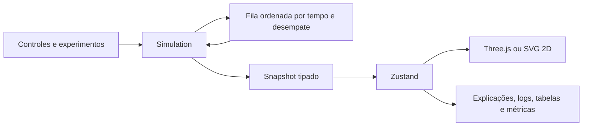

# Arquitetura

O motor não importa React, Three.js, DOM ou serviços de rede. Ele guarda estado serializável e uma fila privada de tarefas. A visualização recebe snapshots, enquanto as posições por quadro consultam o relógio do motor. Assim, pausar a lógica também pausa a posição dos pacotes.

## Módulos

`types.ts` define dispositivos, enlaces, pacotes, eventos, configurações e métricas. `network.ts` cria grafos de cenário, identifica caminhos ativos e consulta prefixos IP pelo maior comprimento. `Simulation.ts` é o controlador: agendamento, geração determinística de perdas, roteamento, transporte, diagnóstico e cenários.

`useSimulation.ts` mantém uma única instância do motor. `act()` executa uma alteração e publica seu snapshot. `App.tsx` tem um único ciclo `requestAnimationFrame`, cancelado no desmontar, que avança a lógica em cada quadro e publica snapshots aproximadamente a cada 100 ms enquanto há reprodução. A escala de reprodução é aplicada antes de `tick`; o motor escala a velocidade selecionada.

`NetworkScene.tsx` renderiza só a cena visível. As geometrias são procedurais; os rótulos usam CanvasTexture com descarte no desmontar. A configuração automática reduz pixel ratio se a taxa observada cair abaixo de 35 FPS; isso não constitui garantia de desempenho. Uma fronteira de erro e o botão de mapa disponibilizam a alternativa SVG.

## Invariantes

- A fila usa tempo virtual e número de ordem como desempate estável.
- `pause()` não consome eventos. `step()` executa exatamente uma tarefa lógica; uma tarefa pode gerar vários registros pertinentes à mesma decisão.
- Reset limpa eventos pendentes, IDs, seed, pacotes e métricas. Não sobrevivem callbacks de cenários anteriores.
- `restartTraffic()` preserva equipamentos, conexões e tabelas, reiniciando somente a experiência de tráfego.
- Pacotes guardam origem/destino final, MAC atual, caminho previsto, histórico efetivo e instante de criação.
- A posição visual interpola somente entre os dois nós do salto atual.
- Logs, tabelas, throughput e explicações são consequências dos mesmos eventos.
- JSON do laboratório é validado antes de substituir o estado; não executa código.

## Limites de recursos

Logs retêm até 800 eventos, amostras de gráfico até 300 pontos e a lista principal de pacotes tem limite de retenção de 400 no envio. Cópias de flooding transitórias podem elevar esse limite durante uma rajada. Laboratório aceita até 30 dispositivos, 100 enlaces e arquivos de 100 KB pela interface. Retransmissões são limitadas a três. O motor aborta uma drenagem de testes acima de 20.000 tarefas.

Nomes do grupo ficam somente em localStorage. Laboratório usa exportação explícita para arquivo local. Não há autenticação, telemetria, armazenamento remoto ou backend de aplicação.

## Fundação do mundo persistente

`src/world/Lab` compõe o HUD; `LabCanvas` mantém o único Canvas no modo mundo e realiza culling por vizinhança. `Navigation` usa vetores/Euler reutilizados; `PacketField` usa InstancedMesh a partir dos timestamps do motor; `Hologram` compartilha o uniforme de relógio publicado por Clock. O renderer legado, quando dentro de WorldMode, mostra SVG e não cria Canvas adicional. O relógio do App desliga no modo mundo; Clock assume via useFrame. Sem WebGL, WorldFallback usa o RAF equivalente. Os terminais continuam usando as funcionalidades existentes; são escondidos no mundo e abertos pelo HUD. Limites e status estão em WORLD_PROGRESS.md.

## Reconstrução de 18/11/2026

`SimpleScene` e `NetworkMap` não importam Three.js. O chunk `LabCanvas` só é solicitado ao escolher o mundo; a aula com gráficos (`Lessons`) também é carregada separadamente. A tela anterior e seu inspetor são desmontados enquanto o mundo ocupa a área principal.

`LabCanvas` mantém um único renderer; as 12 zonas são módulos lazy em `src/world/zones`, com prefetch das vizinhas. A arquitetura estática dá uma composição própria a cada assunto. Instâncias de teclas, grades, pacotes e barras reduzem chamadas de desenho. O ambiente PBR é gerado localmente e descartado no cleanup. Rótulos do mundo usam uma camada DOM dedicada, preservando nitidez quando o DPR diminui; as bancadas usam HTML transformado com controles reais.

`Clock` consulta e avança o motor por quadro, enquanto snapshots React ficam limitados a cerca de dez atualizações por segundo. Ao pausar, o relógio dos shaders e dos pacotes também para. A aba oculta suspende o render loop. O DPR automático usa histerese (três amostras baixas para reduzir, seis altas para aumentar), com faixa 0,75–1,5. O perfil manual tem prioridade. Isso é adaptação, não promessa de FPS universal.

A organização force-directed roda em `layout.worker.ts`; só altera posições visuais, preservando dispositivos, enlaces e lógica de encaminhamento. Arrastar usa interseção raio/plano e limita atualização a cerca de 30 ms. O motor em `src/engine` permaneceu byte a byte idêntico ao inventário da auditoria.

`ExpandPanel` encapsula expansão nativa com alternativa CSS e restauração por Escape. O modo mundo possui seu próprio botão de tela cheia. O menu, o mapa, a lista de equipamentos e as explicações começam recolhidos no celular, mantendo as ações principais acessíveis.

O shell do App assina apenas cenário, estado de reprodução e preferências com seleção superficial. O áudio observa IDs de eventos em um componente sem DOM; a conclusão de missão observa um booleano derivado. O relógio, portanto, não força a navegação inteira a renderizar a cada snapshot. Em repouso, o mundo desenha sob demanda. Câmera, órbita, seleção, hover e deslocamento solicitam quadros enquanto há movimento; reprodução e métricas usam o loop contínuo. A navegação continua funcionando com a lógica pausada. O enquadramento inicial se adapta à proporção da tela e ao assunto.

Cabos compartilhados em `zones/Cable.tsx` comparam coordenadas e estado, preservando a geometria entre snapshots. Isso evita recriar buffers e descartar materiais de `Line` a cada atualização do relógio; alterações de posição, conexão e topologia continuam reconstruindo a forma necessária. A comparação é por valor das coordenadas, pois os snapshots clonam os arrays.

O feedback de recebimento usa o anel do equipamento, já existente, com mudança de opacidade. Não adiciona/remove luzes pontuais a cada pacote. A iluminação da cena mantém um conjunto estável de luzes, evitando variantes de shader dependentes do número de equipamentos recebendo simultaneamente.
