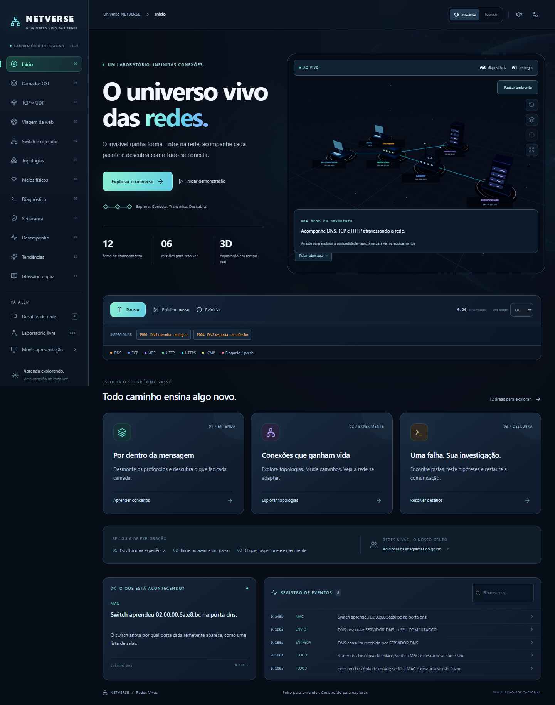

# NETVERSE · O universo vivo das redes

Explore. Conecte. Transmita. Descubra.

Laboratório educacional de redes de computadores construído para o trabalho **Redes Vivas**, da disciplina Introdução à Rede de Computadores. Interface em português, equipamentos 3D inspecionáveis, pacotes derivados de um motor de eventos e execução local após instalação. Apresentação indicada pelo prompt: **18/11/2026**, 10–15 minutos, grupo de 5–8 integrantes.



## Explorar o laboratório

A entrada abre na **visão leve**, com mapa interativo, aulas e navegação com nomes completos. **Mundo 3D** ou **Entrar no laboratório** leva ao mesmo ambiente com 12 áreas. **Ver telas** volta à leitura; **Controles e conteúdo** abre a aula da área sem criar outro mundo.

No mundo, use a navegação lateral ou **Mapa do laboratório**. Arraste para orbitar, use a roda para aproximar ou WASD/setas para deslocar. **Controles da cena** abre a bancada interativa; ela começa recolhida para preservar a visão. Em Topologias, arraste os dispositivos, clique nos cabos ou organize o grafo pelo worker. **Equipamentos** oferece inspeção também por teclado.

O botão **Tela cheia** no alto à direita expande o mundo. O pequeno ícone quadrado na explicação expande apenas o texto; Escape restaura a visão. Esses recursos também estão nas aulas da versão leve. **P / Métricas 3D** mostra contadores reais; nas preferências é possível selecionar a qualidade gráfica. A qualidade automática adapta a resolução sem alterar a simulação.

## Abrir a entrega ZIP

Extraia tudo e execute `INICIAR-NETVERSE.bat`. Com Node.js 24 instalado, a versão compilada abre no navegador **sem instalar dependências**. O iniciador serve apenas arquivos locais em `127.0.0.1`; não exige internet, conta, API ou banco. O diretório `dist` acompanha o ZIP, mas não o histórico Git.

## Desenvolver no VS Code

Abra `ABRIR-NO-VSCODE.bat`, `netverse.code-workspace` ou esta pasta pelo VS Code. Recomendação: Node.js 24 LTS; a base Vite 7 requer Node 20.19+ ou 22.12+. Instale as dependências antes da apresentação:

```bash
npm install
npm run dev
```

Abra o endereço Local mostrado no terminal, normalmente `http://127.0.0.1:5173`. Para instalação exatamente conforme o lockfile, use `npm ci`.

```bash
npm run typecheck
npm run lint
npm test
npm run build
npm run preview
```

Após o build, `npm start` ou `node scripts/serve.mjs` abre a versão compilada. O servidor embutido usa apenas módulos nativos do Node. Em macOS/Linux: `node scripts/serve.mjs`. Ctrl+C encerra o servidor. Não abra `dist/index.html` por `file://`: os módulos JavaScript precisam do servidor HTTP local.

## O que explorar

| Área                   | Experiência                                                                        |
| ---------------------- | ---------------------------------------------------------------------------------- |
| Início                 | Rede 3D, guia, integrantes configuráveis e acessos rápidos                         |
| Camadas OSI / TCP-IP   | Sete camadas, quatro grupos TCP/IP, mensagem editável e encapsulamento progressivo |
| TCP × UDP              | Handshake, pistas paralelas, perda, timeout e retransmissão                        |
| Viagem da web          | DNS, TCP, HTTP GET, três fragmentos, ACKs e página montada                         |
| Comutação e roteamento | Tabela MAC, flooding, prefixos de rota editáveis e MAC por salto                   |
| Topologias             | Estrela, barramento, anel e malha; enlaces e equipamentos desligáveis              |
| Meios físicos          | Par trançado, fibra e Wi-Fi com condições configuráveis                            |
| Diagnóstico            | Terminal local: ping, tracert, ipconfig, nslookup; desafio DNS                     |
| Segurança              | Regras editáveis, Telnet/HTTPS, fila DDoS virtual, contraste HTTP/TLS              |
| Desempenho             | Banda, latência, perdas, concorrência, gráfico e gargalo de 1/4 da banda           |
| Tendências             | Serviços IaaS/PaaS/SaaS, quatro sensores IoT, política SDN                         |
| Glossário e quiz       | 32 verbetes, filtros, 24 questões, explicações e pontuação                         |

O laboratório adicional permite criar, arrastar, conectar, inspecionar e endereçar equipamentos, enviar unidades de dados e salvar/carregar a topologia em JSON. O modo apresentação oferece nove paradas. Seis missões têm objetivos, dicas progressivas e 100 pontos por resultado verificado: primeira conexão, pacote perdido, cabo quebrado, firewall, DNS e rota. A viagem web também reconhece recuperação após perda.

## Como usar

1. Escolha uma área. Clique **Iniciar** ou **Próximo passo**.
2. **Pausar** congela o relógio virtual e os pacotes; a câmera permanece disponível.
3. Mude um parâmetro em **Experimente**. A alteração vale nos próximos saltos.
4. Clique no equipamento, no pacote, na lista de pacotes ou no log para inspecionar.
5. **Reproduzir** reinicia o tráfego mantendo topologia e falhas; **Reiniciar** restaura a rede gerada para os parâmetros atuais.
6. A cena pode ser orbitada, aproximada, acompanhada e restaurada. O mapa 2D preserva controles e inspeção.

O tempo didático de 1× corresponde a 180 ms virtuais por segundo real; a velocidade muda a reprodução, não as regras de rede. Endereços privados e o bloco de documentação `203.0.113.0/24` identificam máquinas fictícias.

## Arquitetura e stack

React 19, TypeScript, Vite 7, Tailwind CSS 4, Three.js, React Three Fiber, Drei, Zustand, Lucide e Recharts. Vitest verifica o motor e Playwright verifica a interface. CSS organiza a identidade e as transições; GSAP e shadcn não foram necessários para o comportamento implementado. Fontes são do sistema e rótulos 3D usam texturas de Canvas locais, sem CDN.

```text
src/engine/       entidades, grafo e motor determinístico
src/stores/       ponte entre motor e React
src/scenes/       visualização 3D, câmera e mapa 2D
src/components/   controles, inspeção, logs e experimentos
src/features/     experiências específicas e laboratório
src/data/         currículo, glossário e questões
src/app/          navegação, apresentação e ciclo de reprodução
src/tests/        testes do motor
e2e/              testes reais de navegador
public/assets/    arte local otimizada
scripts/          servidor estático e empacotamento
```

## Precisão e limites

É um modelo didático, não uma pilha TCP/IP real. Não captura ou ataca redes. Simplifica ARP, congestionamento TCP, números de sequência, checksum, filas e física dos meios. TLS é uma representação conceitual; não cifra bytes de verdade. Barramento é um meio compartilhado modelado com repetidor; anel é bidirecional com busca de caminhos, sem Token Ring. Não há STP, BGP, OSPF, VLAN ou pacotes reais. Valores de desempenho são calculados pelo motor, não benchmarks de hardware.

O projeto prioriza o conteúdo acadêmico e a causalidade. Não há promessa de qualidade de jogo AAA ou 60 FPS em qualquer máquina. As diferenças de acabamento e os limites completos estão em [REQUISITOS.md](REQUISITOS.md) e [SIMULATION.md](SIMULATION.md).

## Documentação e transparência

- [Requisitos e rastreabilidade](REQUISITOS.md)
- [Arquitetura](ARCHITECTURE.md) e [modelo da simulação](SIMULATION.md)
- [Roteiro de apresentação](APRESENTACAO.md) e [guia para compreender o código](GUIA-DO-GRUPO.md)
- [Testes e evidências](TESTING.md), [contribuição](CONTRIBUTING.md), [inovações](INOVACOES.md)
- [Assets, créditos e referências](ASSETS.md) e [alterações](CHANGELOG.md)

O código, a revisão e uma arte decorativa foram desenvolvidos com auxílio de IA (Codex e geração de imagem). Isso deve ser informado na apresentação. O grupo deve estudar, testar e compreender a implementação. Os integrantes reais são cadastrados no Início; nenhum nome foi inventado. As capturas de tela acima e em `docs/screenshots` são capturas do programa funcionando, não imagens geradas.

## Interface e abertura 3D

O Início combina apresentação, cena Three.js orbital e tráfego automático derivado do motor. A faixa de atividade mostra dispositivos e entregas reais. Use Pausar ambiente para interromper a demonstração ou arraste a cena para explorar os equipamentos. A interface compartilha estilos de navegação, controles, cartões e painéis, com composições próprias para desktop, tablet e celular e respeito à preferência por movimento reduzido.

## Exploração das camadas

Na tela OSI, use os controles no topo para acompanhar a mensagem entre origem e destino. Selecione uma camada para inspecioná-la; Seguir mensagem retoma o acompanhamento do motor. Os blocos de PDU são didáticos. As outras telas priorizam a ferramenta relevante para sua tarefa. O código 3D é carregado separadamente, com pausa de desenho fora da área visível.

## Entre no laboratório

No Início, use **Entrar no laboratório** para abrir a exploração imersiva. Arraste para orientar a câmera, role para aproximar e, no computador, use W/A/S/D para se deslocar. Selecione equipamentos diretamente na cena ou na faixa inferior para comparar IP, MAC e função. A missão acompanha três inspeções e uma entrega real do motor. Esc ou Sair do laboratório retorna à interface. A cena ao fundo suspende seu desenho enquanto o modo está aberto.

As jornadas da página inicial permitem escolher um objetivo e explorar suas três áreas. A busca no topo aceita Ctrl+K e navegação por teclado. OSI inclui perguntas com feedback e acesso direto à camada pertinente.

## Prévia do mundo persistente

O mundo oferece navegação por zonas, WASD/setas, arraste, aproximação e pointer lock opcional (Esc libera o mouse). Use Terminal da zona para acessar experiências e controles completos; Voltar ao mundo fecha o terminal. Visão simplificada retorna ao layout acessível existente. P mostra instrumentação real. Controles de movimento também aparecem por toque. A etapa ainda é um protótipo: veja WORLD_PROGRESS.md para as funcionalidades e verificações pendentes.

## Gerar novamente o pacote

Após `npm run build`, execute `python scripts/package.py`. Em um checkout Git, o empacotador inclui os arquivos controlados pelo repositório e o build em `dist`, evitando incluir cópias locais de sincronização ou arquivos avulsos. Sem metadados Git, usa a lista de pastas do projeto. O ZIP e seu SHA-256 ficam em `release`.
